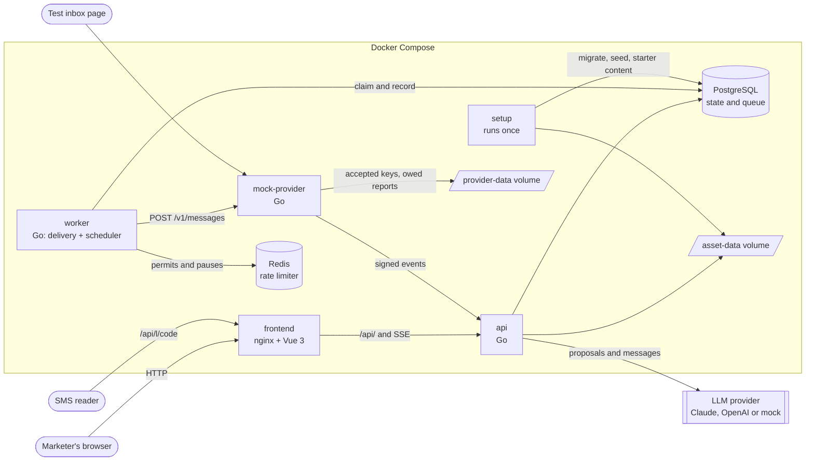
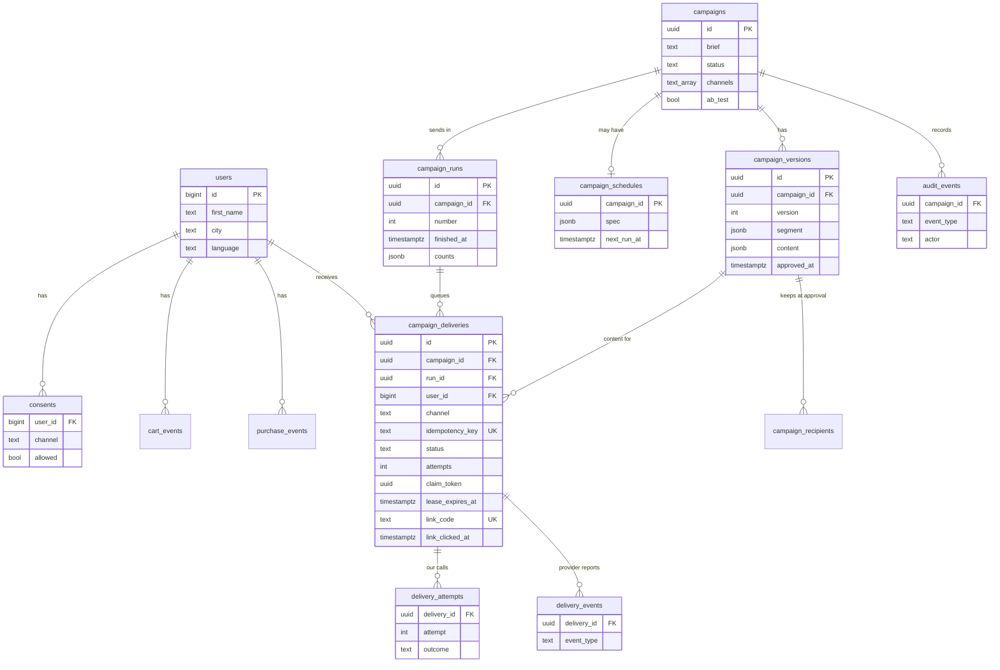

# Architecture

How the system is put together: which processes run, what each one owns and where the data lives. For how a campaign moves through these parts, see [flows.md](flows.md). For why it is built this way, see [DECISIONS.md](../DECISIONS.md).

## System overview

The API and the worker never call each other. They share PostgreSQL, so either can restart or scale on its own, and a page that reconnects simply reads the current state. The one exception is a status check: the API pings the worker, the provider and Redis to show their state to the marketer. None of them affects the API's own readiness, which covers only PostgreSQL.

## Processes

| Service | Port on the host | Role |
|---|---|---|
| `frontend` | 8080 | nginx serves the Vue app and forwards `/api/` to the API, with buffering off so events arrive as they are produced |
| `api` | 8081 | HTTP API, LLM calls, validation, approval, live progress over SSE, provider webhook, and the short link redirect at `/api/l/<code>`, which counts the click |
| `worker` | 8082 (health and metrics only) | Sends messages, recovers expired leases, closes finished campaigns, pauses stalled ones, runs schedules |
| `mock-provider` | 8083 (test inbox) | Stands in for an SMS and email provider: idempotency keys, failures, delivery reports and a test inbox. It writes each accepted key and the reports it still owes to a journal on the `provider-data` volume before it answers, and replays it when it starts |
| `setup` | none | Runs once before the API and worker: migrations, seed users, starter templates |
| `postgres` | none | All durable state, including the delivery queue |
| `redis` | none | Shared rate limiter. Per channel: the sliding window, a pause after a 429, a credential lock after a 401, and a key that says the window is whole. It runs without persistence, so it always starts empty |

## Where each thing is decided

| Rule | Enforced by |
|---|---|
| Model output is untrusted | `segment.ParseProposal` and `content.ParseGenerated`. Nothing unvalidated is stored |
| An audience query cannot be injected or mean "everyone" | `segment.Compile` uses fixed fragments and parameters, and an empty rule compiles to `FALSE` |
| Nothing is sent without approval | Status checks in `campaign.Service`, and the worker only claims from campaigns in `DISPATCHING` |
| An approved version cannot change | Database trigger on `campaign_versions` |
| One message per run, person and channel | Unique key `(run_id, user_id, channel)` on `campaign_deliveries`. A repeating campaign has a run for each send, and its schedule says whether a later run may reach someone again |
| A retry is the same message to the provider | Each delivery's `idempotency_key`, sent with every attempt and kept when a crashed worker's message is taken back |
| 100 calls per second per channel, as the provider counts them | Redis sliding window, shared by all workers. Clock steps beyond 100 ms can let a few calls through; see the [reviewer guide](reviewer-guide.md#3-rate-limiting-across-workers-and-failures) |
| A stale worker cannot overwrite a result | `claim_token` must still match when recording |
| The history of decisions cannot be edited | Append-only `audit_events`, written in the same transaction as the change |

## Data model

The main tables, with only the columns that explain how they connect.

Three tables stand apart from campaigns, because a campaign keeps its own copy of what it took from them: `email_designs` (templates), `saved_segments` (reusable audiences) and `brand_profile`. `assets` lists uploaded images, whose files sit on the `asset-data` volume. `starter_content` records that the starter templates were loaded.

`campaign_deliveries` is both the record of each message and the send queue. Keeping them together means a status and its place in the queue change in one transaction.

`campaign_runs` holds one row per send of a campaign: one for a send now or a one-time schedule, one for each time a repeating schedule fires. Every delivery belongs to a run, and a finished run keeps its counts, so reports and lists read them without counting the deliveries again.

## Code map

| Path | What it holds |
|---|---|
| `cmd/api`, `cmd/worker`, `cmd/mock-provider`, `cmd/setup` | Entry points that wire the packages together |
| `internal/httpapi` | Routes, sign-in, SSE streams, CSV export, unsubscribe and provider webhook handlers |
| `internal/campaign` | The core rules: proposals, generation, approval, dispatch, scheduling, reports |
| `internal/segment` | Audience rule: parsing model output, comparing it with the brief, compiling it to SQL |
| `internal/content` | Message rules: validation, limits, email rendering, partial stream parsing |
| `internal/matching` | Reads facts out of a marketer's text without a model |
| `internal/ai` | LLM providers behind one interface: Anthropic, OpenAI and a deterministic mock |
| `internal/delivery` | Worker loops, rate limiter, circuit breaker, provider client |
| `internal/schedule` | Schedule rules: when a campaign next sends |
| `internal/mockprovider` | The mock provider, its test inbox and webhook |
| `internal/asset`, `internal/starter` | Image processing and storage, starter templates |
| `internal/language`, `internal/unsubscribe` | Supported languages, signed unsubscribe links |
| `internal/telemetry`, `internal/health`, `internal/server`, `internal/db` | Metrics, logs, spans, health endpoints, HTTP server, database connection |
| `internal/seed`, `internal/testsupport` | Demo data, test helpers |
| `frontend/src/views`, `components`, `api`, `lib` | Pages, shared components, API client, frontend logic |
| `migrations/` | SQL schema, applied by `setup` |
| `tests/e2e`, `tests/chaos`, `tests/benchmark` | Acceptance, failure and model-limit tests |
| `tests/verify` | Load scenarios under faults, security probes and the mutation check, run on their own stack ([README](../tests/verify/README.md)) |

## Observability

| Signal | Source |
|---|---|
| Metrics | `/metrics` on the API and worker, with fixed labels only |
| Logs | JSON on stdout through `slog` |
| Traces | OpenTelemetry spans, exported when `OTEL_EXPORTER_OTLP_ENDPOINT` is set. A delivery carries the trace context of the send that queued it |
| Business record | `audit_events`, which also feeds the Activity tab and the notification bell |
