# Flows

How a campaign moves through the system, from a brief to a report. For the parts these flows run on, see [architecture.md](architecture.md).

## The whole journey

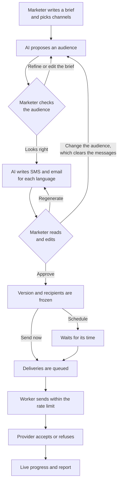

A person acts at every decision above. The model only proposes, and nothing reaches a customer until someone approves it.

## Campaign status

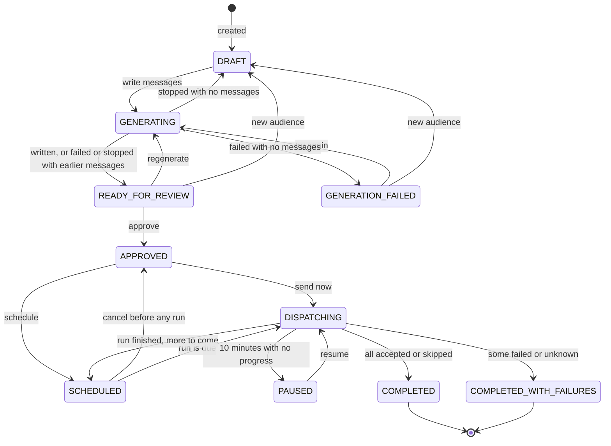

- Duplicating a campaign starts a new one in `DRAFT`, or in `READY_FOR_REVIEW` when it already has messages.
- A claim on `GENERATING` older than five minutes counts as left behind by a dead process, so a new generation can take it over.
- Leaving out every language that has messages also returns the campaign to `DRAFT`.
- A repeating run with nobody new to queue stays in `SCHEDULED`.
- Cancelling a schedule that has already run lets the campaign finish with what it has sent.

## Proposing an audience

`POST /api/campaigns/{id}/segment` answers with the saved proposal. The same path handles a first proposal, a refinement and an edited brief. A campaign started from a saved audience keeps that rule and skips the model until someone asks to change it.

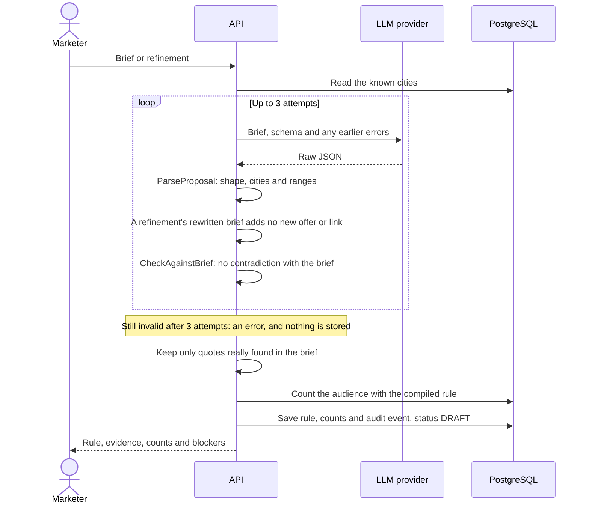

What the checks find goes to one of three levels:

| Finding | Result |
|---|---|
| The rule clearly contradicts the brief | Sent back to the model. If it cannot fix it, nothing is stored |
| A condition about who receives the message is not in the rule | Red: blocks generation and approval until the person resolves it |
| A reading the backend cannot confirm | Yellow: shown, and the person decides |

## Writing the messages

`POST /api/campaigns/{id}/generate` answers with a stream. What streams is a preview: only output that passes validation is stored.

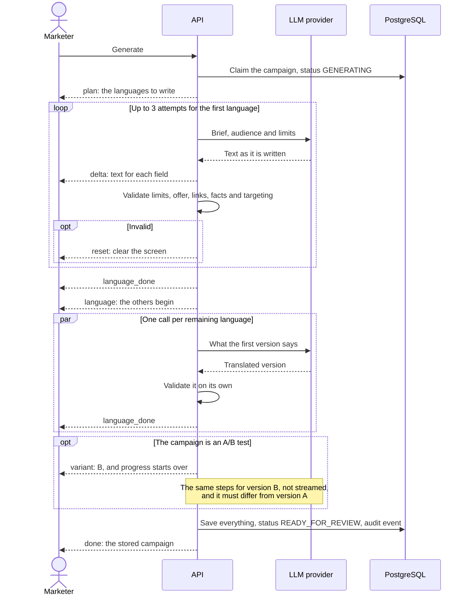

- **All or none:** if one language fails, nothing is saved, so an audience is never left with some messages out of date.
- **Stopping:** closing the page or pressing Stop cancels the calls and puts the campaign back as it was. That is not recorded as a failure.
- **Limits:** SMS and subject lengths are checked against the longest first name that will really be sent, per language.
- **Smaller runs:** regenerating on a step rewrites only that channel, and adding a language writes only that language.

## Approving and queuing

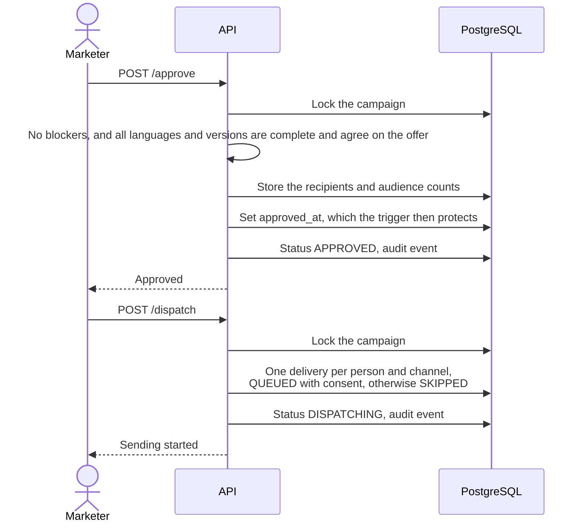

The approval page stays closed until each language version has been opened. Repeating either call changes nothing. In an A/B test, each person's side comes from a hash of the campaign and the person, so a retry or a later run never moves them. `POST /schedule` replaces `/dispatch` when the send should wait: see [Scheduling](#scheduling).

## Sending a message

Each worker runs one loop per channel, with up to 32 calls in flight, so one channel's outage does not hold up the other. Permission comes before a claim, so a channel that has to wait holds no messages.

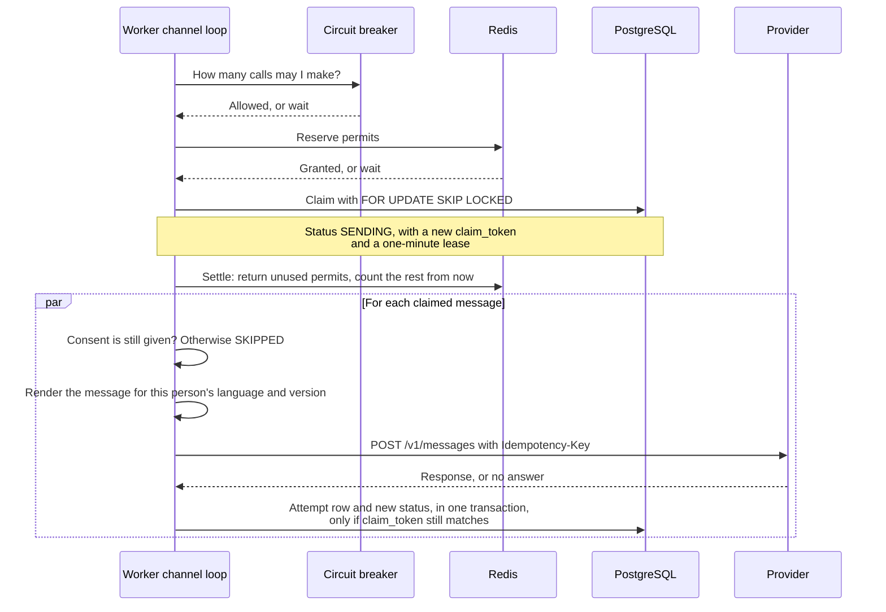

What the provider's answer leads to:

| Answer | Next status | Uses an attempt |
|---|---|---|
| 2xx | `SENT` | Yes |
| 429 | `RETRYING` after `Retry-After`, and the whole channel pauses | No |
| Other 4xx | `FAILED` | Yes |
| 5xx or 408 | `RETRYING` with backoff, up to 5 attempts | Yes |
| No answer in time | `RETRYING` with backoff, up to 5 attempts | Yes |
| Provider cannot be reached | `RETRYING`, and the channel rests for 5 seconds | No |
| Failed probe while the breaker tests the provider | `RETRYING` with backoff | No |

When attempts run out, a delivery with any timeout behind it ends as `UNKNOWN`, because the provider may have accepted the message. Otherwise it ends as `FAILED`.

## Delivery status

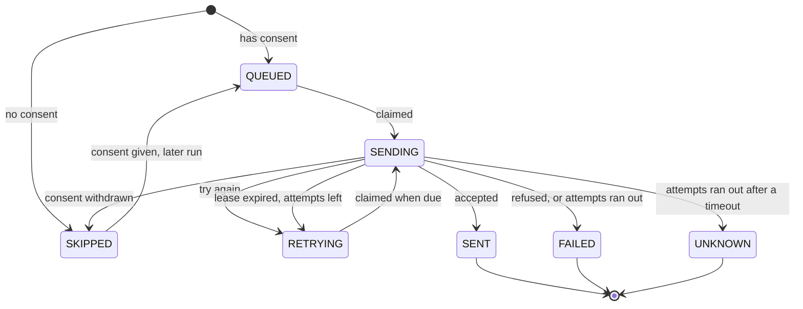

`SENT` means the provider accepted the message, not that a person received it. What became of it afterwards is recorded separately: see [Provider reports](#provider-reports).

## Keeping the queue moving

Each worker also runs these on a timer, alongside its channel loops:

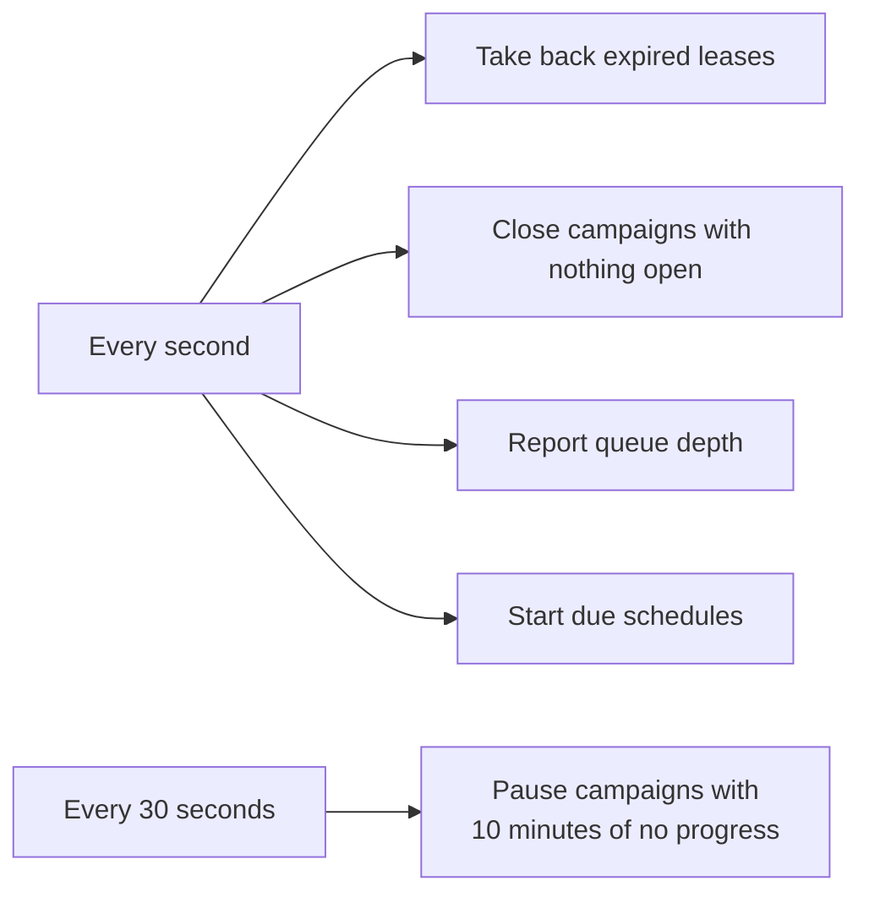

- **Worker crash:** a message left in `SENDING` is taken back when its lease ends, and this counts as an attempt with the outcome `timeout`. It is sent again with the same idempotency key, or ends as `UNKNOWN` if attempts have run out.
- **Provider failing:** when at least 20 calls in 10 seconds include 50% failures, the breaker holds the channel. It then sends three probes after 5 seconds, doubling up to 30, and messages stay queued in the meantime.
- **Redis down:** nothing is sent until it returns, and no attempt is used.
- **Postgres down:** workers wait and carry on when it returns.
- **Long outage:** a campaign with messages waiting on retries and none finishing for 10 minutes becomes `PAUSED`. Its messages keep their place, and only a person's Resume starts it again.

`make test-chaos` runs these failures against a running stack.

## Scheduling

A schedule is a row in `campaign_schedules`, including its next run time, so it survives restarts. The worker checks for due rows every second.

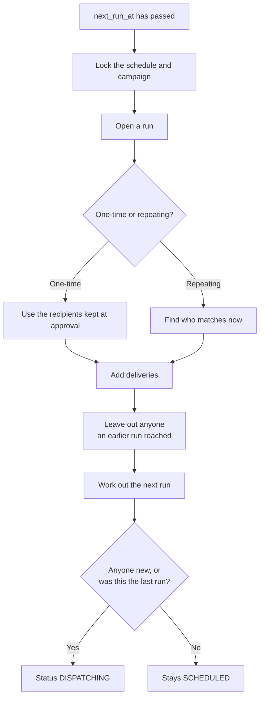

Missed runs are not replayed one by one: after downtime, one run covers them, because each run already reaches everyone still owed the message. A run's counts are kept once its last delivery finishes.

## Provider reports

A delivery's status only comes from our own calls. What the provider says later is stored separately in `delivery_events`.

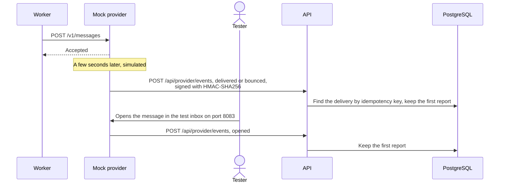

Delivered and bounced are simulated, and the screens say so. Opens are counted only when someone really opens a message in the test inbox.

## Live progress

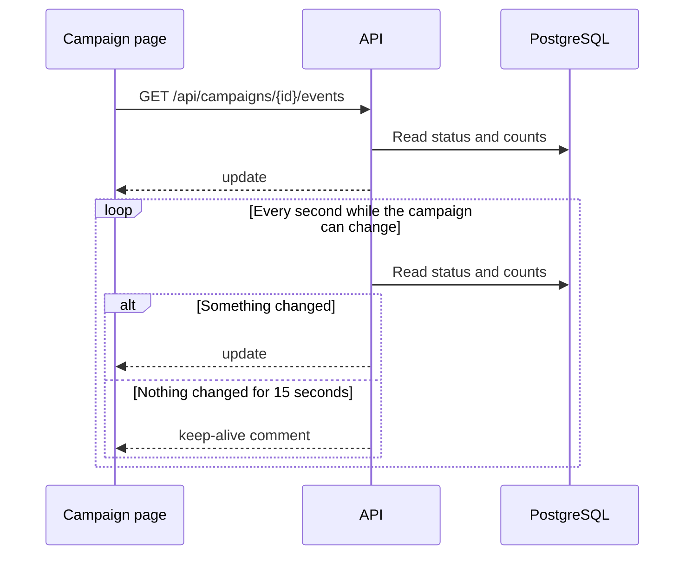

Workers can run anywhere, so the database is the one place that knows the truth, and a page that reconnects simply gets the current state.

## Unsubscribing

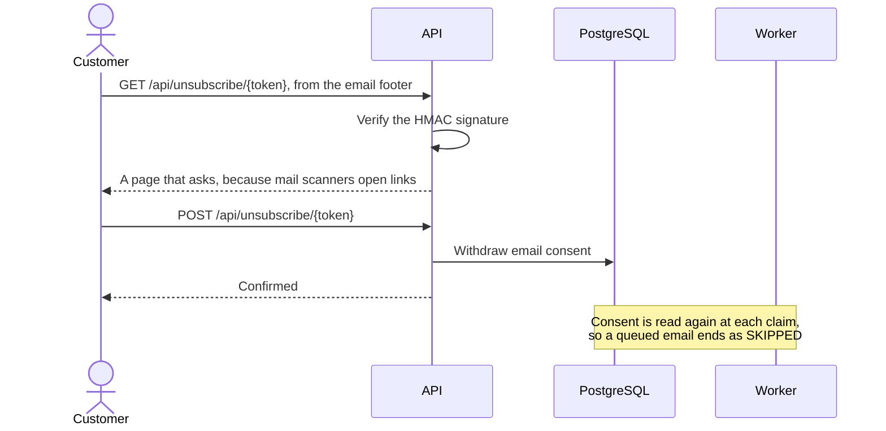

SMS consent does not change.

## Starting up

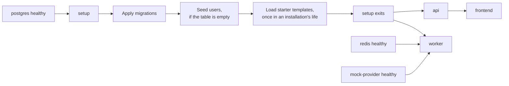
