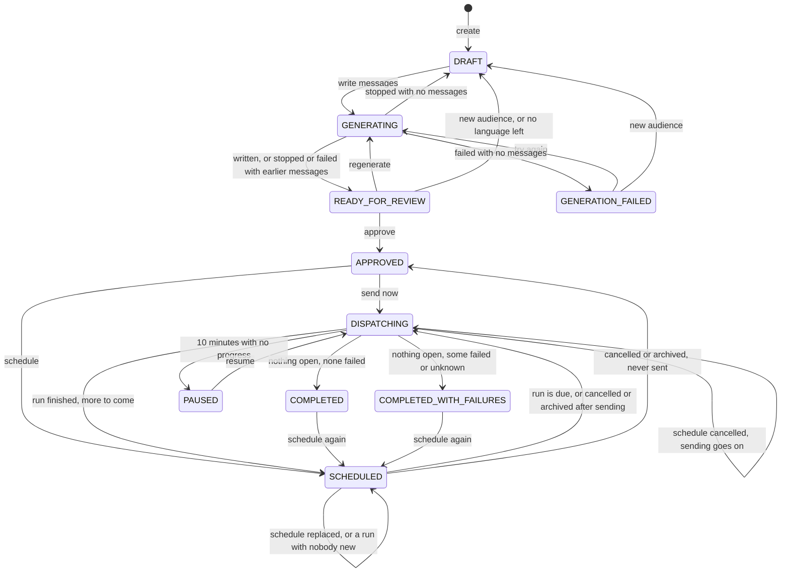
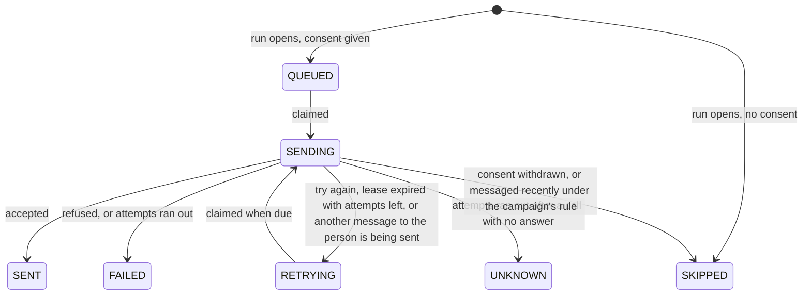

# State machines

Several parts of the system move through fixed states, but only a few of them have a status column. This page lists each one with:

- where its state lives;
- which code moves it, and under what guard;
- what must always hold;
- what happens after a crash or when two processes act at once.

[flows.md](flows.md) shows the same journeys as diagrams for a reader new to the product. This page is the reference to check before adding or changing a transition.

## The rules every machine follows

- **A transition is one transaction.** The status, the rows that go with it and the audit event commit together or not at all. A crash leaves the state from before the transition, never half of one.
- **A campaign's status changes only under its row lock.** Every path takes `SELECT … FOR UPDATE` on the campaign row, or writes with an `UPDATE … WHERE status = …` guard, before it checks the current status. Two requests or workers can therefore never both act on the same state.
- **The database has the last word on what may exist.** Where a rule cannot be a constraint, the code checks it under the lock, and this page says so.
- **Time is the database's.** Leases, stall clocks and "abandoned" checks compare against `now()` in PostgreSQL, so workers on different hosts agree. The rate limiter is the exception: it reads Redis's clock, as described in [errors-and-retries.md](errors-and-retries.md#how-calls-count-against-the-limit).

## Overview

| Machine | Where its state lives | Moved by |
|---|---|---|
| [Campaign](#campaign) | `campaigns.status`, `status_since` | API requests, the scheduler, the worker |
| [Writing claim](#writing-claim) | `campaigns.status = 'GENERATING'`, `generation_claim` and `updated_at` | `POST /generate` |
| [Messages document](#messages-document) | `campaign_versions.content`, `ContentRevision` | Generation, edits, language choices |
| [Delivery](#delivery) | `campaign_deliveries.status`, `claim_token`, `lease_expires_at`, `attempts` | The worker |
| [Run](#run) | `campaign_runs.finished_at` and its counts | Sending, the worker |
| [Schedule](#schedule) | Whether the `campaign_schedules` row exists, `next_run_at`, `runs` | API requests, the scheduler |
| [Archive and delete](#archive-and-delete) | `campaigns.archived_at`, `deleted_at` | API requests |
| [Channel gate](#channel-gate) | Redis keys per channel, and each worker's breaker in memory | The worker |
| [Channel alerts](#channel-alerts) | The latest `campaign.alert_opened` or `campaign.alert_closed` event | The worker |
| [Starter content](#starter-content) | One row in `starter_content` | `setup` |
| [Browser state](#browser-state) | Component state and `localStorage` | The frontend |

## Campaign

**State:**
- `campaigns.status`, one of 11 values that a `CHECK` constraint allows.
- `status_since` is when the campaign entered that status. A trigger sets it on every change of status; a new scheduled run also resets it.
- `updated_at` moves on any edit, a rename included. Nothing that measures how long a campaign has been in a state reads it, apart from the [writing claim](#writing-claim).

### Transitions

| From | To | Trigger | Code | Guard |
|---|---|---|---|---|
| — | `DRAFT`, or `READY_FOR_REVIEW` for a copy with messages | Create, duplicate | `Create`, `Duplicate` in [service.go](../internal/campaign/service.go) | — |
| `DRAFT`, `READY_FOR_REVIEW`, `GENERATION_FAILED`, or an abandoned `GENERATING` | `GENERATING` | Write messages | `StartGeneration` in [generate.go](../internal/campaign/generate.go) | `UPDATE … WHERE freeToDraft` |
| `GENERATING` | `READY_FOR_REVIEW` | Output saved | `Generation.save` | `WHERE status = 'GENERATING'` |
| `GENERATING` | `READY_FOR_REVIEW`, `DRAFT` or `GENERATION_FAILED` | Failure or stop | `Generation.recordFailure` | `WHERE status = 'GENERATING'` |
| Same set as `GENERATING`'s sources | `DRAFT` | New audience | `saveProposal` in [service.go](../internal/campaign/service.go) | `UPDATE … WHERE freeToDraft` |
| `DRAFT`, `READY_FOR_REVIEW`, `GENERATION_FAILED` | `DRAFT` | The last language with messages left out | `SetExcludedLanguages` | Row lock |
| `READY_FOR_REVIEW` | `APPROVED` | Approve | `ApproveAt` in [dispatch.go](../internal/campaign/dispatch.go) | Row lock, the review revision the page showed, no blockers, every version complete |
| `APPROVED` | `DISPATCHING` | Send now | `Dispatch` | Row lock, not archived |
| `APPROVED`, `SCHEDULED`, `COMPLETED`, `COMPLETED_WITH_FAILURES` | `SCHEDULED` | Schedule | `Schedule` in [schedule.go](../internal/campaign/schedule.go) | Row lock, not archived |
| `SCHEDULED`, `DISPATCHING` | `DISPATCHING`, or stays `SCHEDULED` | A run is due | `Scheduler.runOne` | `FOR UPDATE OF s, c SKIP LOCKED` |
| `SCHEDULED`, `DISPATCHING`, `PAUSED` | `APPROVED` if it never sent, otherwise `DISPATCHING`; `PAUSED` stays `PAUSED` | Cancel the schedule | `CancelSchedule` | Row lock, `hasSent` |
| `SCHEDULED` | `APPROVED` if it never sent, otherwise `DISPATCHING` | Archive | `Archive` in [organize.go](../internal/campaign/organize.go) | Row lock, `hasSent` |
| `DISPATCHING` | `COMPLETED`, `COMPLETED_WITH_FAILURES` or `SCHEDULED` | Nothing open | `finishCampaign` in [worker.go](../internal/delivery/worker.go) | Row lock, then a fresh look for open deliveries |
| `DISPATCHING` | `PAUSED` | Waiting on retries with nothing finishing for 10 minutes | `pauseCampaign` | Row lock, the condition read again |
| `PAUSED` | `DISPATCHING` | Resume | `Resume` | Row lock |

Repeating a request that has already taken effect changes nothing: approving an approved campaign, sending one that is sending and resuming one that runs all answer with the campaign as it is.

### Invariants

Enforced by the database:

- The status is one of the 11 values.
- An approved version cannot change: a trigger refuses any update or delete of a `campaign_versions` row with `approved_at`.

Kept by the code under the row lock:

- **Approval:** `APPROVED`, `SCHEDULED`, `DISPATCHING`, `PAUSED` and both completed statuses have a version with `approved_at` set and its recipients stored. A draft status has none.
- **Sending:** `SCHEDULED` has a schedule with `next_run_at` set and no open delivery. `DISPATCHING` either has a run with open deliveries, or is waiting for the worker to close it.
- **Pause:** `PAUSED` has at least one `RETRYING` delivery, and no delivery is claimed while it lasts, because the claim reads the campaign's status.
- **Sent once, sent forever:** a campaign with a run never returns to `APPROVED` or a draft status. Archive and cancel both ask `hasSent`, which reads `campaign_runs`. A schedule's own `runs` count is not enough, because it misses a send started with "send now".
- **Delete:** only a campaign that never sent and never had a schedule can be deleted.

### Crash and concurrency

- **A crashed API process:** it leaves the campaign as it was before the request. The one exception is `GENERATING`, which the [writing claim](#writing-claim) takes back after five minutes.
- **Two workers finishing the last deliveries at once:** each may see the other's delivery as still open. The worker therefore closes campaigns on a timer as well, and `finishCampaign` checks again under the lock, in a statement of its own after the wait.
- **A scheduled run and closing:** they take the same row lock, so a run cannot add deliveries to a campaign that is being closed.

## Writing claim

`GENERATING` is also a lock held by one model run.

- **Taking it:** `StartGeneration` locks the campaign row, reads the campaign and takes the claim with a guarded `UPDATE`, all in one transaction. The claim gets a new token in `generation_claim`, and the run keeps it. The generation works from that copy until it saves, so it must be the state it claimed: a copy read before the lock would let a new audience, a change of languages or an edit that committed in between be saved over.
- **Keeping it:** while writing, `stillRunning` touches `updated_at` before each version, only while its token is the campaign's.
- **Taking it over:** a claim untouched for five minutes counts as left by a dead process, and `freeToDraft` lets a new request take it.
- **Releasing it:** the claim ends when `save` or `recordFailure` moves the status on and clears the token. Both write only while the run's token is the campaign's, so a run whose claim was taken over saves nothing, releases nothing and reports no failure. A new audience on an abandoned claim clears the token too.
- **Stopping:** stopping cancels the model calls and is not recorded as a failure.

A database constraint holds the token to the status: `generation_claim` is set exactly while the status is `GENERATING`.

One version can take at most 3 attempts of 90 seconds, which leaves 30 seconds of margin under the five minutes, so a takeover of a live run needs one stalled for minutes. If it happens, the run that took over owns the result, and the older run's output is dropped. A rename while writing also moves `updated_at` and so delays a takeover.

## Messages document

The messages live as one JSON document per campaign version: every language, and version B of a test. Generation writes it whole, a person's edit rewrites it whole, and leaving out a language removes that language's entries.

- **Empty:** a campaign with no messages stores `{}`, never `NULL`. This holds both after a new audience and after the last language is left out.
- **Revision:** `ContentRevision`, sent with the campaign as `content_revision`, is a short hash of the stored document. A save sends back the revision it was made to, and one made to an older revision is refused with `409`. That covers another tab, or a regeneration that finished in between, which would otherwise be undone without a word. Inside the save, the document is read again under the campaign's row lock and compared to the one the edit was made to, so a change between the read and the write is refused even without a revision.
- **Review:** `ReviewRevision`, sent as `review_revision`, covers the messages and the audience they go to. Every approval must name one: without it the API answers `400`, and the service has no way to approve without it. Approval compares it under the row lock, so only what the review page showed is frozen.
- **Edits:** edits are allowed only in `READY_FOR_REVIEW`. After approval the version is frozen by the trigger above.
- **Name:** `name_source` moves from the brief to `ai` to `user`, and `user` stays: a model's suggestion never replaces a name someone typed.

## Delivery

**State:**
- `campaign_deliveries.status`.
- `claim_token` and `lease_expires_at`, set only while `SENDING`.
- `attempts`, `next_attempt_at` and `last_error`.

The table in [flows.md](flows.md#sending-a-message) says which provider answer leads where.

`SENT`, `FAILED`, `UNKNOWN` and `SKIPPED` are final. Someone skipped in one run can get a new delivery, with a new idempotency key, in a later run; the skipped row itself never changes.

### Transitions

| From | To | Code | Guard |
|---|---|---|---|
| — | `QUEUED` or `SKIPPED` | `insertDeliveries` in [dispatch.go](../internal/campaign/dispatch.go) | The run's transaction; unique `(run_id, user_id, channel)` |
| `QUEUED`, `RETRYING` | `SENDING` | `claim` in [worker.go](../internal/delivery/worker.go) | Due, campaign `DISPATCHING`, `FOR UPDATE SKIP LOCKED`, new `claim_token` |
| `SENDING` | Any outcome | `record` | `WHERE claim_token = $2 AND status = 'SENDING'`; the attempt row commits with it |
| `SENDING` with an expired lease | `RETRYING`, or `UNKNOWN` at the last attempt | `RecoverExpired` | `FOR UPDATE SKIP LOCKED`; the attempt row commits with it |
| `SENDING`, not confirmed by the limiter | `RETRYING`, no attempt used | `settle` | Same as `record` |
| `SENDING`, while another run overlaps (see below) | `SKIPPED` (`messaged_recently`) or `RETRYING` (`another_message_sending`), no attempt used | `holdBack` | One batch, run as one implicit transaction: the person's advisory lock, then the check and its write in a statement of its own, so the check reads after the lock is granted and the lock holds until the write commits |

### Invariants

- Each delivery has one idempotency key, `run:user:channel`, and the provider sees the same key on every retry. A message accepted twice is answered as a duplicate.
- A person gets at most one delivery per channel in a run (`UNIQUE (run_id, user_id, channel)`).
- `claim_token` and `lease_expires_at` are set exactly while the status is `SENDING`.
- Only the holder of the current `claim_token` can record an outcome. A late answer after the lease was taken back changes nothing.
- `attempts` counts calls that may have reached the provider. A 429, a 401, an unreachable provider and a failed probe of the breaker cost none.

### Crash and concurrency

- **Worker crash:** a worker that dies after claiming leaves its rows in `SENDING`. After the one-minute lease, any worker takes them back and counts an attempt, because the call may have gone out. The retry carries the same key, so the provider does not accept it twice. A message whose workers keep crashing ends as `UNKNOWN` instead of looping. It can also end that way without ever having reached the provider.
- **Lease and call timing:** the lease is far longer than a call: at most a 5-second limiter settle, a 5-second call and a 5-second record. A lease can therefore run out under a live worker only if that worker is stopped for most of a minute, and then the idempotency key still prevents a second acceptance.
- **Two sends to one person:** a message under a "not messaged recently" rule is checked just before its call, under a lock per person. Two such messages claimed together take turns: the first to look sees the other being sent and steps back, writing that before the second looks, so the second goes and the first is later skipped. A message without the rule waits under the same lock while a message with the rule to the same person is being sent, so it cannot slip in between that check and its call. A message with the rule checks only when another run has been open since its queuing counted, and one without only while a run with the rule is open, so a campaign sending on its own does no extra work (see DECISIONS).
- **Graceful stop:** a worker that stops gracefully finishes the calls it has started, within `MaxDrain`, before it exits.

## Run

**State:** `finished_at`, `total`, `counts` and `responses`. A `CHECK` makes them all null or all set.

| From | To | Code |
|---|---|---|
| — | Open | `openRun` with `queueRun`, in the same transaction as its deliveries |
| Open | Finished | `finishRuns` in [worker.go](../internal/delivery/worker.go), once none of its deliveries is open |

A run gets all its deliveries when it opens, and a final delivery never changes. The counts written at the finish are therefore final. Two workers finishing the same run cannot both write it: the second `UPDATE` reads the row again after the first commits and finds `finished_at` set.

## Schedule

The schedule has no status column; its state is read from its row:

| State | Row |
|---|---|
| None | No row |
| Waiting | `next_run_at` set |
| Ran out | `next_run_at` null and the rule has nothing after `last_run_at` |
| Stopped | `next_run_at` null while the rule would have run again, or before it ever ran |

**Transitions:**
- `Schedule` inserts the row or replaces its rule.
- `Scheduler.runOne` moves `next_run_at` on and increments `runs`, in the transaction that opens the run.
- `CancelSchedule` and `Archive` clear `next_run_at`, or delete the row if the campaign never sent.

**Invariants:**
- A campaign that is archived, deleted, `APPROVED` or a draft has no `next_run_at`. Archive and cancel clear it, and delete is refused while a schedule exists. The scheduler itself only looks at `SCHEDULED` and `DISPATCHING` campaigns.
- Missed runs are not replayed one by one: after downtime, one run covers them.

**Crash and concurrency:** a crash between finding a due run and committing it leaves `next_run_at` where it was, so the run starts on the next tick. Any number of schedulers can run, since each skips rows another has locked.

## Archive and delete

These two columns lie across the status, rather than being statuses of their own.

- **Archive:**
  - Archiving sets `archived_at`. It is refused while the campaign is writing, sending or paused.
  - A `SCHEDULED` campaign loses its later sends: it goes back to `APPROVED` if it never sent, or to `DISPATCHING` so the worker closes it with what it sent.
  - Restoring clears `archived_at` and does not bring the schedule back.
  - An archived campaign cannot send, schedule or approve. It also cannot write messages, change its audience or languages, or take an edit. Every one of these paths goes through `lockStatus`, which refuses it under the row lock, so archiving and a change cannot pass each other. Renaming and tags stay open, since they only organize the list.
- **Delete:**
  - Deleting sets `deleted_at`. It is final, and every page and count leaves the campaign out.
  - The row stays because the append-only audit trail points at it.

## Channel gate

Whether a channel may call the provider is decided per channel. Most of that state is shared in Redis, and part of it is held by each worker. [errors-and-retries.md](errors-and-retries.md) describes each case in full.

| State | Where | Entered | Left |
|---|---|---|---|
| Window lost | No `intact:<channel>` key | Redis restarted, flushed or evicted | After about 8 s (a call, its answer margin and one grant window), by the script that grants permits |
| Paused | `pause:<channel>` with an expiry | A 429, an unreachable provider, a breaker trip | The key expires |
| Credentials refused | `credentials:<channel>` with `locked`, `gen` and `probe_at` | A 401 | A probe from the current `gen` is accepted |
| Breaker open, then probing | Each worker's memory | 50% failures over at least 20 calls in 10 s | 3 probes pass; a failed probe doubles the wait up to 30 s |
| Open | None of the above | | |

**Guarantees:**
- Each Redis step is one Lua script, so the check and the change happen together across every worker.
- The credentials lock is versioned by `gen`, so a late answer to an older lock's probe cannot open a newer lock.
- The breaker is not shared. Each worker trips on its own calls, and a trip writes a pause to Redis so that the others hold too.
- If Redis loses the credentials lock, the next 401 sets it again; those calls cost their messages no attempt.

## Channel alerts

An alert has no table: whether it is open is read from the latest `campaign.alert_opened` or `campaign.alert_closed` event for that campaign, channel and kind.

- **Kinds:** `credentials_refused`, `no_progress` and `error_rate`.
- **Open and close conditions:** they differ, so an alert cannot flap on a borderline reading (`decideAlert` in [alerts.go](../internal/delivery/alerts.go)).
- **Stall clock:** `no_progress` uses `status_since`, so a campaign counts as long-running from when it started or resumed sending.
- **Writing once:** `setAlert` locks that campaign, channel and kind, then reads the latest event again. Workers that check at the same moment therefore write one event between them.

## Starter content

`starter_content` holds at most one row (`CHECK (only_row)`). `setup` locks the table, adds the templates if the row is missing, and writes the row in the same transaction. A template deleted later is not brought back, and two `setup` processes at once add the templates once.

## Browser state

The frontend keeps some state that the server does not enforce.

- **Approval reading:** the approve button stays closed until every language and test version has been opened. This lives only in the page's memory ([ReviewView.vue](../frontend/src/views/ReviewView.vue)), since opening a version is not proof of reading it ([DECISIONS.md](../DECISIONS.md#approval-is-slower-on-purpose)). What the server does hold to is that the page approves what it showed: it sends back `review_revision`, a hash of the messages, the audience rule and its date, the brief and the languages left out. A campaign changed since, in another tab or by a colleague, is refused with `409`, and a request with no revision, from a script or any other client, with `400`.
- **Status rules shown as buttons:** archive, delete and schedule-again are offered for the statuses the backend accepts ([CampaignDetailView.vue](../frontend/src/views/CampaignDetailView.vue)). The backend checks again, so a stale page gets an error, not a wrong change.
- **Derived row labels:** "Waiting for next run" and "Sending run #n" are read from `SCHEDULED` or `DISPATCHING` plus the schedule ([campaignStatus.ts](../frontend/src/lib/campaignStatus.ts)).
- **Live updates:** the SSE connection reconnects by itself, and the page says when its numbers may be out of date.
- **Notifications:** which ones a person has seen or cleared is kept in `localStorage`.

## Adding a transition

1. Take the campaign's row lock, or write with a guard on the current status, before checking anything.
2. Write the status, the rows that go with it and the audit event in one transaction.
3. If the transition depends on whether the campaign has sent, use `hasSent`.
4. Add the edge to the table and diagram above, and a test that runs it from every status it should refuse.
5. If the frontend offers the action, keep its status list in step with the backend's guard.

## Found and fixed on 2026-11-07

A review of these machines found four bugs. Each was reproduced against the test database before the fix and now has a test:

| Bug | Cause | Fix |
|---|---|---|
| Archiving a campaign that was sent at once and then scheduled made it `APPROVED`, which offered "Send now" again after a restore | Archive read the schedule's `runs` count, which a send started with "send now" does not raise | Archive and cancel both use `hasSent` |
| Two saves of the messages made from the same page state: the second undid the first without an error | Each save replaces the whole document and nothing checked what it was made to | `content_revision`, and a check under the row lock |
| Leaving out the only language with messages failed with a database error | The empty document was written as `NULL` | It is written as `{}` |
| Renaming or tagging a stuck campaign kept it from pausing | The stall clock and the alerts read `updated_at` | They read `status_since`, which only a change of status or a new run moves |

## Found and fixed later

Each fix has its own issue and pull request, and a test that fails without it.

| Issue | Bug | Cause | Fix |
|---|---|---|---|
| [#2](https://github.com/negativexq/smart-campaign-composer/issues/2) | Approving froze whatever was stored at that moment. Messages edited in another tab, rewritten or written for a new audience after the review page loaded were approved unseen | The approval request carried nothing about what the page showed | `review_revision`, compared under the row lock; an older one gets `409` |
| [#3](https://github.com/negativexq/smart-campaign-composer/issues/3) | A regeneration undid an edit made just before it started, and messages written for a replaced audience were saved as ready for review. A campaign deleted at that moment started generating and called the model | `StartGeneration` read the campaign, then claimed it in a separate statement, and worked from the earlier copy | Lock, read and claim in one transaction |
| [#4](https://github.com/negativexq/smart-campaign-composer/issues/4) | An archived campaign could start writing messages, which archiving itself refuses, and could take edits and a new audience out of sight | Only sending, scheduling, approving and languages checked for an archived campaign | Generation, audience proposals and edits refuse it under the row lock, including when it is archived while the model answers |
| [#9](https://github.com/negativexq/smart-campaign-composer/issues/9) | A direct API call with no revision still approved what was stored, as before #2 | The revision was optional, so older callers kept working | The revision is required; there is no approval without one |
| [#10](https://github.com/negativexq/smart-campaign-composer/issues/10) | A run still alive after its claim was taken over could save over the newer run, release its claim on failure so a third could start, and keep it alive | The claim stored no owner; its writes checked only `status = 'GENERATING'` | A token per claim, required by every write the run makes, and a constraint tying it to the status |

The `CANCELLED` status is allowed by the constraint and shown by the frontend, but nothing sets it. Cancelling a schedule moves a campaign to one of the statuses above instead.
